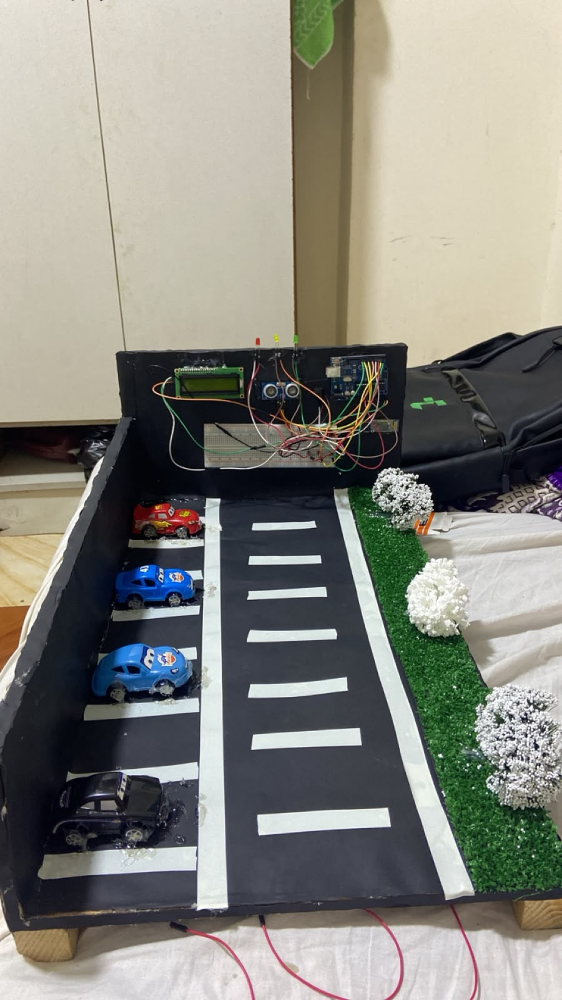
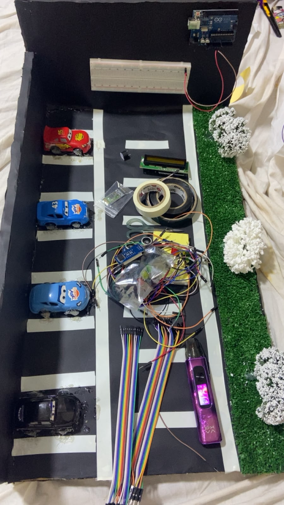
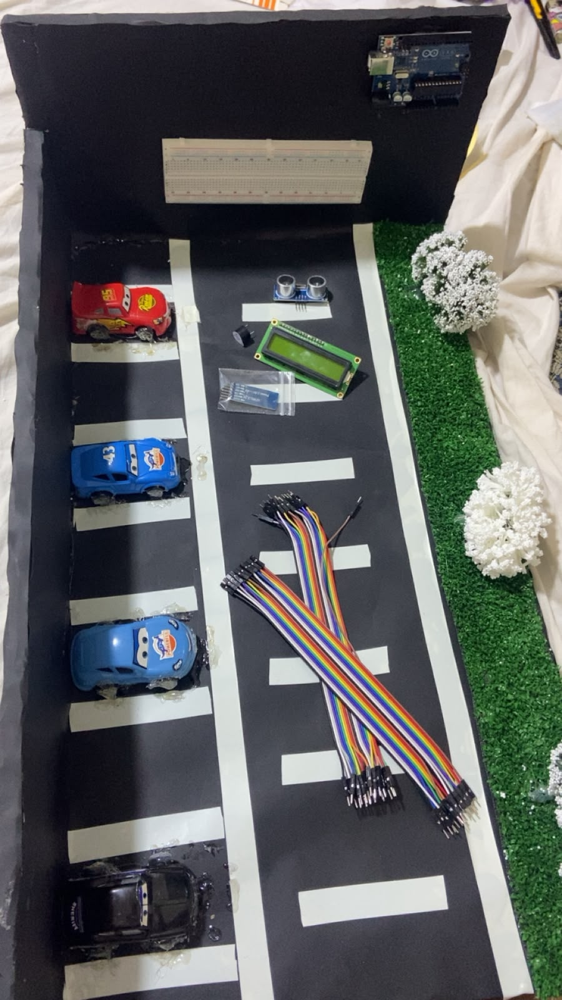
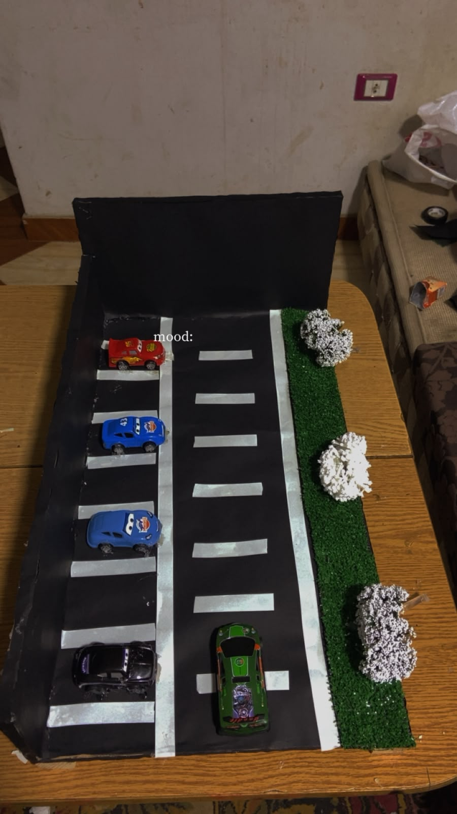
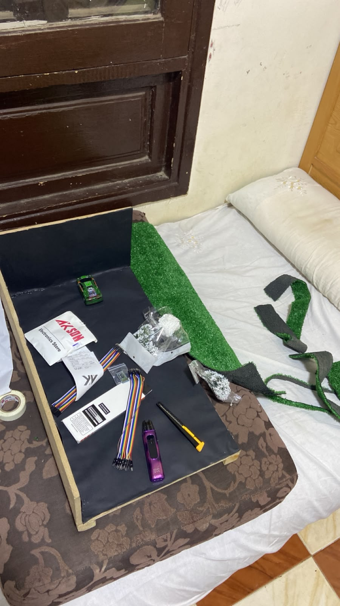

🚗 Smart Parking System

  <b>Arduino-Based Smart Parking Assistant</b>

  
  
  

📌 Project Overview

The Smart Parking System is an Arduino-based project designed to help drivers measure the distance between their vehicle and nearby objects while parking.

The system uses an ultrasonic sensor to detect obstacles and provides visual and audio alerts. It also displays distance information on an LCD screen and sends data to a mobile phone through Bluetooth.

Project Status: Successfully Built & Tested.

✨ Features

* Real-time distance measurement.
* Ultrasonic obstacle detection.
* LCD display for distance information.
* Three LED indicators for different distance levels.
* Buzzer warning system.
* Bluetooth communication with a mobile phone.

🛠️ Components Used

* Arduino Uno
* HC-SR04 Ultrasonic Sensor
* 16x2 I2C LCD Display
* HC-05 / HC-06 Bluetooth Module
* Green LED
* Yellow LED
* Red LED
* Buzzer
* Breadboard
* Jumper Wires
* Resistors

🔌 Pin Connections

Component	Arduino Pin
Green LED	D2
Yellow LED	D3
Red LED	D4
Buzzer	D5
Echo Pin	D7
Trig Pin	D8
Bluetooth RX	D10
Bluetooth TX	D11
LCD SDA	A4
LCD SCL	A5

⚙️ How It Works

1. The HC-SR04 ultrasonic sensor measures the distance to the nearest object.
2. The Arduino receives and processes the distance readings.
3. The LCD displays the measured distance.
4. The LEDs indicate the distance level.
5. The buzzer provides audio warnings when an object gets close.
6. Bluetooth sends distance information to a connected mobile phone.

💻 Programming & Tools

* Programming Language: C++
* Development Environment: Arduino IDE
* Microcontroller: Arduino Uno
* Communication Protocols: I2C and SoftwareSerial

📁 Project Files

* Project_Parking_2.ino — Arduino source code.
* README.md — Project documentation.
* parking1.mp4 — Project demonstration video.
* Project images — Photos of the completed hardware.

🎥 Project Demonstration

▶ Watch Smart Parking System Demo

📸 Project Gallery

### Project Images

## Project Demonstration

[▶ Watch Smart Parking System Demo](parking1.mp4)

🎯 Project Goal

To develop an affordable and practical parking assistance system using Arduino, sensors, and wireless communication.

👨‍💻 Developer

Mahmoud Hamed

AI & Robotics Enthusiast | Python Learner

* GitHub: mahmoud-hamed-ai
* Project Repository: Smart Parking System

⸻

Always learning, building, and improving.
